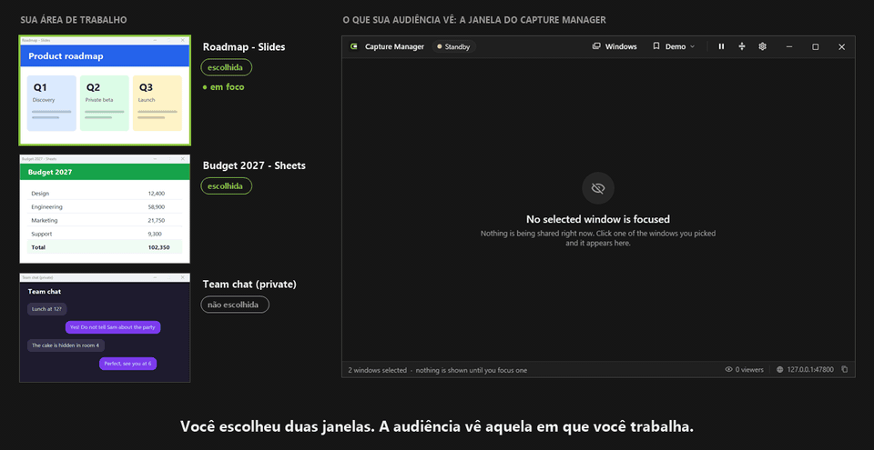
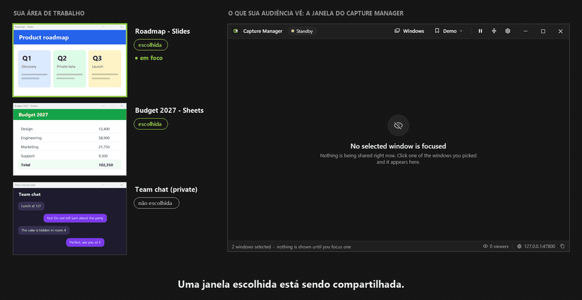
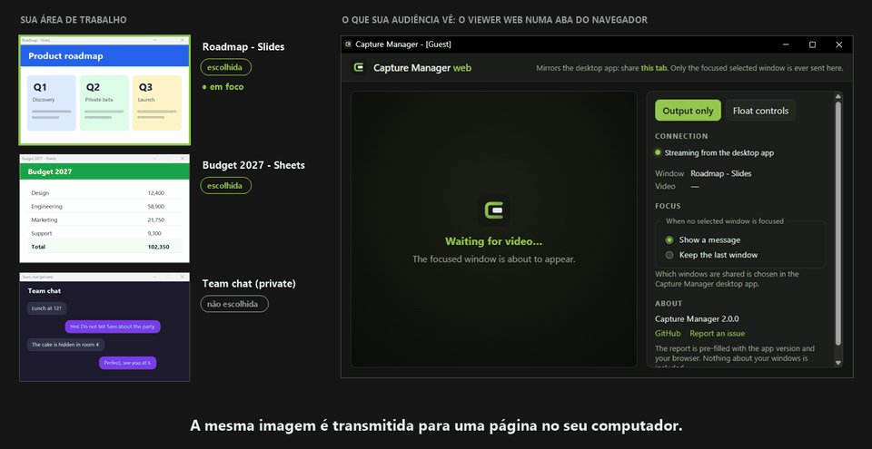

# Capture Manager

[English](README.md) | **Português**

Compartilhe uma janela em vez da tela inteira, e continue trocando de aplicativo.

Você escolhe as janelas que aceita mostrar. O Capture Manager exibe, dentro da própria janela, somente a janela escolhida que está em foco no momento. No Teams, Meet, OBS ou em qualquer outra ferramenta você compartilha a janela do Capture Manager: o que você não escolheu nunca chega à sua audiência.



Por [Codescovery](https://github.com/codescovery). Somente Windows. A interface do aplicativo está em inglês.

## Recursos

- **Escolha as janelas** em uma lista com miniaturas ao vivo; mude a seleção quando quiser.
- **Acompanha o seu foco**: a janela exibida muda conforme você troca de aplicativo. Ao focar algo que não escolheu, a audiência vê uma mensagem, a última janela escolhida ou uma janela fixa (você decide).
- **Pausa** (botão, menu da bandeja ou atalho global, `Ctrl+Alt+P` por padrão): esconde tudo de uma vez até você retomar.
- **Perfis**: salve um conjunto de janelas como regras (programa + título) e recupere depois. Um programa reiniciado é reconhecido de novo sozinho.
- **Viewer web**: a janela exibida também é transmitida para uma página em `http://127.0.0.1:47800/` no mesmo computador, para você compartilhar uma aba do navegador em vez da janela do aplicativo.
- **Roda na bandeja**: fechar a janela mantém a captura e o viewer web funcionando. Início com o Windows opcional.
- **Visão limpa** (`Ctrl+H`): esconde as barras do próprio aplicativo, e a audiência vê só a janela capturada.
- Título personalizado da janela no seletor de compartilhamento e opção de movê-la para uma área de trabalho virtual própria.
- Atualiza-se sozinho quando instalado pelo programa de instalação.

## Requisitos

- Windows 10 versão 2004 ou superior, 64 bits. No Windows 11 24H2 ou superior a captura usa a taxa de atualização completa do monitor.
- Nada mais para instalar: o aplicativo já traz o runtime do .NET.
- Viewer web: Chrome ou Edge recente.

## Instalação

Baixe `CodescoveryCaptureManager-win-Setup.exe` da [versão mais recente](https://github.com/codescovery/capture-manager/releases/latest) e execute. A instalação é feita para o usuário atual, sem direitos de administrador.

`CodescoveryCaptureManager-win-Portable.zip`, na mesma versão, roda sem instalar.

Pacotes para winget (`Codescovery.CaptureManager`) e Chocolatey (`codescovery-capture-manager`) estão preparados em `packaging/`, mas ainda não foram publicados.

## Como usar

1. Abra o Capture Manager e clique em **Windows** para escolher o que deseja expor.
2. Na ferramenta de reunião ou de transmissão, compartilhe a janela chamada **Captured Window** (o nome pode ser alterado em Settings).
3. Trabalhe normalmente. A audiência vê a janela escolhida que estiver em foco.

### Pausa

Pressione `Ctrl+Alt+P` em qualquer programa (ou use o botão de pausa ou o menu da bandeja) para esconder tudo de uma vez. Em pausa nada é exibido, seja qual for a janela em foco. Pressione de novo para retomar. O atalho pode ser alterado em Settings > General.



### OBS

Adicione uma fonte **Captura de Janela**, selecione a janela do Capture Manager e, em **Método de Captura**, escolha **Windows Graphics Capture** (Windows 10 1903 ou superior). Com os outros métodos o OBS mostra uma janela vazia.

### Viewer web

Abra `http://127.0.0.1:47800/` no Chrome ou no Edge (use `127.0.0.1`, não `localhost`) e compartilhe essa aba. **Output only** deixa somente a imagem na aba. O endereço responde apenas neste computador.



## Privacidade

- Somente as janelas que você escolheu são capturadas, e só enquanto estão em foco (ou enquanto você optou por manter uma visível).
- O viewer web escuta no endereço de loopback; nada é enviado para outra máquina.
- O arquivo de log (Settings > About > Open logs folder) registra nomes de programas e identificadores de janela, nunca títulos de janela.

## Problemas

Settings > About > **Report an issue** abre uma issue no GitHub já preenchida com a versão do aplicativo e do Windows. Anexe o log se ajudar.

## Compilar a partir do código

Requer o SDK do .NET 10 e o Node 22 (o build compila o viewer web).

```bash
dotnet build src/Codescovery.CaptureManager.sln
dotnet test  src/Codescovery.CaptureManager.sln
dotnet run --project src/Presentation/CodescoveryCaptureManager.App
```

`-p:SkipWebBuild=true` compila sem o Node; o aplicativo funciona, mas a página do viewer web não é servida.

Sugestões e pull requests são bem-vindos.

As animações acima são gravadas com `.claude/scripts/demo-recorder`, usando janelas de demonstração com conteúdo fictício.

## Licença

[MIT](LICENSE)
